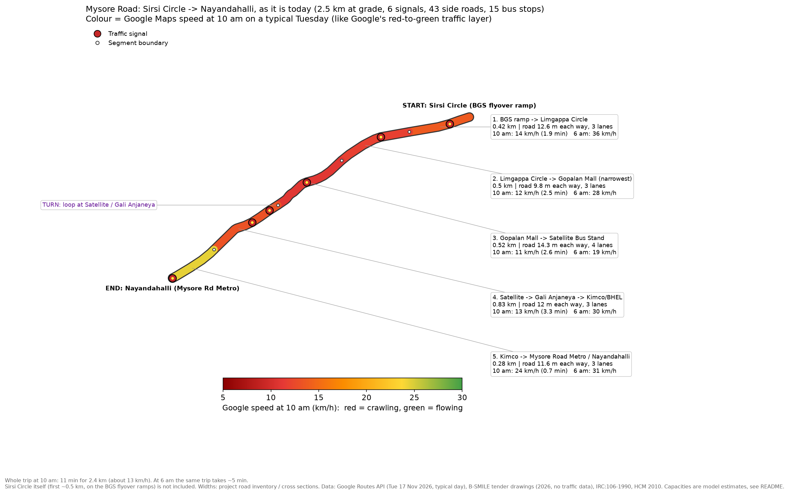
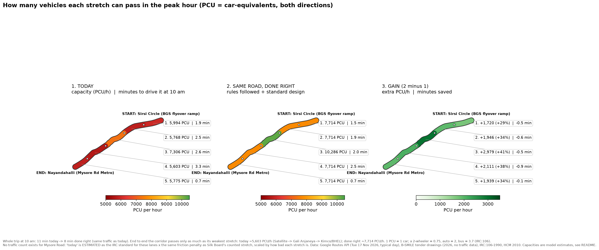
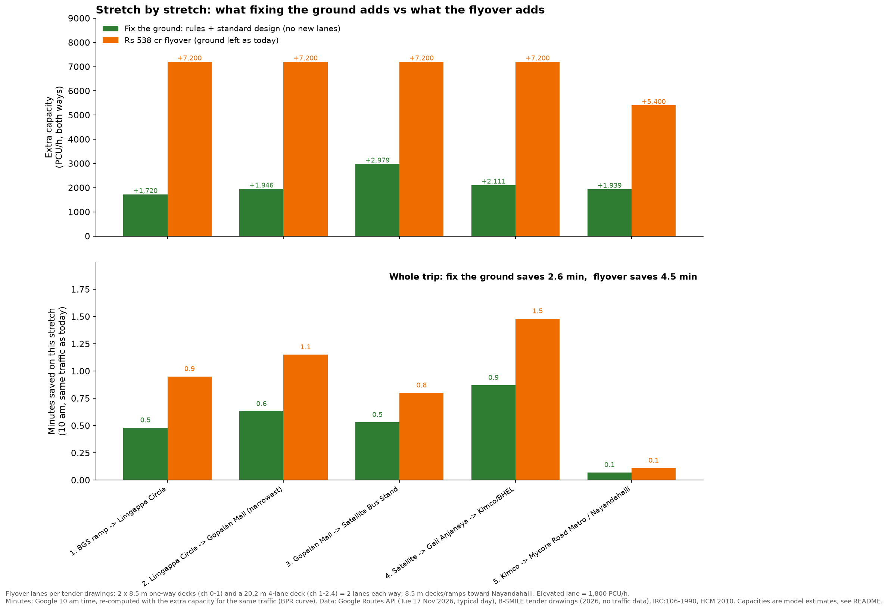
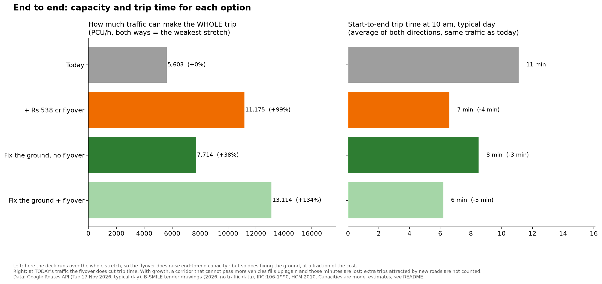
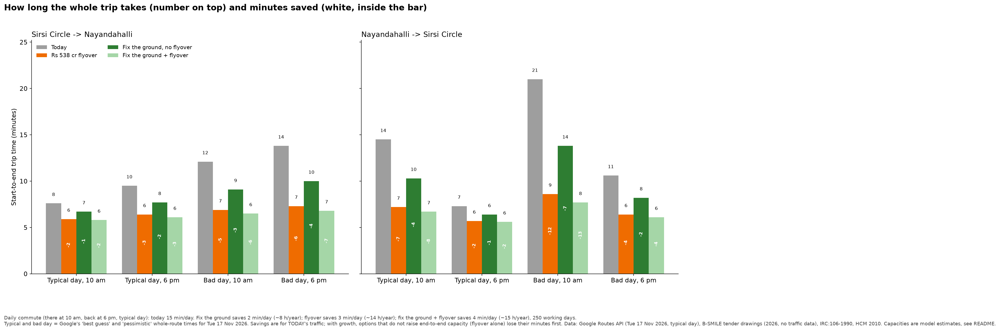

# Mysore Road, Sirsi Circle to Nayandahalli: does it need a Rs 538 crore flyover?

### A plain-language look at the road we already have

---

## First: there is no traffic data

The tender for this flyover costs Rs 538 crore, or **Rs 810 crore with land**. Its documents contain **no traffic count, no vehicle mix, no growth forecast and no speed survey**. There is nothing to check the flyover against. That alone is worth asking about.

So this document is built differently from the Silk Board one:

- **Travel times are real.** They come from Google Maps on a normal Tuesday, measured stretch by stretch in both directions.
- **"How many vehicles each stretch can carry today" is an estimate.** It is the Indian road standard (IRC:106) for these lanes, reduced by the same friction penalty measured on Silk Board's counted stretch. That penalty is scaled by how bad each Mysore Road stretch is: parking, bus stops, pedestrians, signals and surface.

---

## The short answer

**Sirsi Circle (where the BGS flyover lands) to Nayandahalli, about 2.5 km, from Google Maps:**

| When | Today | Fix the ground (no flyover) | Rs 538 cr flyover | Fix the ground + flyover |
|---|---|---|---|---|
| 6 am (empty road) | 5 min | – | – | – |
| 10 am, towards Nayandahalli | **8 min** | 7 (saves 1) | 6 (saves 2) | 6 (saves 2) |
| 10 am, towards Sirsi Circle | **14 min** | 10 (saves 4) | 7 (saves 7) | 7 (saves 8) |
| 6 pm, towards Nayandahalli | **10 min** | 8 (saves 2) | 6 (saves 3) | 6 (saves 3) |
| Bad day, 10 am, towards Sirsi Circle | **21 min** | 14 (saves 7) | 9 (saves 12) | 8 (saves 13) |
| **Daily commute** (to Nayandahalli 10 am, back 6 pm) | **15 min/day** | saves 2 min/day, ~8 h/year | saves 3 min/day, ~14 h/year | saves 4 min/day, ~15 h/year |

- **This corridor is short.** At 6 am the trip takes 5 minutes. At peak it takes 8–14 minutes, and up to 21 on a bad day. The worst part is the morning run towards the city, past the Satellite Bus Stand and Gali Anjaneya.
- **Fixing the ground helps every stretch.** Same lanes, rules followed, bus bays and organised bus-stand entry, footpaths, working signals: **+38% more vehicles can make the whole trip**, saving 1–4 minutes on a typical day and up to 7 on a bad day.
- **Here the flyover does beat fixing the ground.** This is the opposite of Silk Board. The deck runs over the whole stretch, with 2 new lanes each way, so it adds more capacity and saves more time: 2–7 minutes on a typical day, up to 12 on a bad day.
- **But the gain is small for the money.** For a daily commuter, the flyover saves about **1–2 minutes a day more** than fixing the ground, roughly 6 extra hours a year, for Rs 538–810 crore.
- **The model does not look past the two ends.** Traffic on the deck lands on the existing BGS flyover at Sirsi Circle, where goods vehicles are already restricted at peak hours. At the other end it lands at the Nayandahalli junction under the ORR flyover, the worst crash black spot on this road. If either end is already full, the minutes saved on the deck are lost there.

All minutes are for **today's traffic**. "Bad day" is Google's pessimistic estimate for the same Tuesday.

---

## 1. The road today

**What you're looking at.** The road from Sirsi Circle (top right, where the BGS flyover comes down) to Nayandahalli (bottom left), cut into **5 stretches** at the main junctions. The colour is Google Maps' speed at **10 am on a normal Tuesday**.

| | |
|---|---|
| Length modelled | ~2.5 km at ground level. Sirsi Circle itself, about 0.5 km on the BGS flyover ramps, is left out |
| Traffic signals | 7 on the full tender stretch, 6 in the part modelled |
| Side roads joining | 43, about one every 160 m on each side. There is **no service road** for most of the way |
| Bus stops | 15, with **no bus bays** drawn |
| Biggest friction | **Satellite Bus Stand (KSRTC + BMTC)**, about 800 buses a day entering, leaving and stopping on the road |
| Narrowest | **Limgappa Circle → Gopalan Mall: 9.8 m each way**, about 2.8 m lanes on one side, 26 m between buildings (the city plan says 30–45 m) |
| Other | 8 petrol pumps open straight onto the road. Metro pillars run along the south edge near Nayandahalli |

**The slowest stretches at 10 am:**

| Stretch | Speed at 10 am | Speed at 6 am |
|---|---|---|
| 3. Gopalan Mall → Satellite Bus Stand | 11 km/h | 19 km/h |
| 2. Limgappa Circle → Gopalan Mall | 12 km/h | 28 km/h |
| 4. Satellite → Gali Anjaneya → Kimco | 13 km/h | 30 km/h |

---

## 2. How much each stretch can carry: today vs done right

**PCU** means "passenger car unit": one car = 1, a two-wheeler = 0.75, an auto = 2, a bus = 3.7. Each label shows **capacity (PCU per hour) | minutes to drive that stretch at 10 am**.

| Stretch | Today (estimated): PCU/h, minutes | Done right: PCU/h, minutes | Gain |
|---|---|---|---|
| 1. BGS ramp → Limgappa Circle | 5,994, 2.0 min | 7,714, 1.5 min | +1,720 (+29%), **0.5 min saved** |
| 2. Limgappa Circle → Gopalan Mall | 5,768, 2.5 min | 7,714, 1.9 min | +1,946 (+34%), **0.6 min saved** |
| 3. Gopalan Mall → Satellite Bus Stand | 7,306, 2.6 min | 10,286, 2.1 min | +2,979 (+41%), **0.5 min saved** |
| **4. Satellite → Gali Anjaneya → Kimco** | **5,603, 3.3 min** | 7,714, 2.5 min | **+2,111 (+38%), 0.9 min saved** |
| 5. Kimco → Nayandahalli | 5,775, 0.7 min | 7,714, 0.7 min | +1,939 (+34%), 0.1 min saved |
| **Whole trip** | **11.1 min** | **8.5 min** | **2.6 min saved** |

The minutes in this table are the average of both directions at 10 am. Stretch 4, through Satellite and Gali Anjaneya, is today's **bottleneck**: it has the least capacity on the corridor.

**What "done right" means here:**

- **Enforcement:** no stopping in lanes, which is critical near the bus stand and petrol pumps; tow parked vehicles; yellow boxes at junctions.
- **Design:**
  - Bus bays.
  - A **proper entry and exit for the Satellite Bus Stand** so buses don't stop on the main road.
  - Fewer median gaps.
  - A service road or controlled access for the 43 side roads.
  - Continuous footpaths.
- **Signals:** adaptive and coordinated, with no manual override.
- **Maintenance:** surface and drains, including the Vrishabhavathi crossings.

---

## 3. Fixing the ground vs building the flyover, stretch by stretch

| Stretch | Fix the ground: extra PCU, minutes saved | Flyover: extra PCU, minutes saved |
|---|---|---|
| 1. BGS ramp → Limgappa | +1,720, 0.5 | +7,200, 1.0 |
| 2. Limgappa → Gopalan Mall | +1,946, 0.6 | +7,200, 1.2 |
| 3. Gopalan Mall → Satellite | +2,979, 0.5 | +7,200, 0.8 |
| 4. Satellite → Kimco | +2,111, 0.9 | +7,200, 1.5 |
| 5. Kimco → Nayandahalli | +1,939, 0.1 | +5,400, 0.1 |
| **Whole trip** | **2.6 min** | **4.5 min** |

Unlike Silk Board, **the flyover covers every stretch here**, so it adds more on each one. That is what 2 new lanes each way over the whole road buys.

---

## 4. End to end

| Option | Vehicles that can make the whole trip | Trip time at 10 am* | Time saved |
|---|---|---|---|
| Today (estimated) | 5,603 PCU/h | 11 min | – |
| **Fix the ground, no flyover** | **7,714 PCU/h (+38%)** | **8.5 min** | **2.6 min** |
| Rs 538 cr flyover | 11,175 PCU/h (+99%) | 6.6 min | 4.5 min |
| Fix the ground + flyover | 13,114 PCU/h (+134%) | 6.2 min | 4.9 min |

*Typical day, average of both directions.

---

## 5. Start to end: how long the whole trip takes

| Sirsi Circle → Nayandahalli | Today | Flyover | **Fix ground** | Fix ground + flyover |
|---|---|---|---|---|
| Typical day, 10 am | 8 | 6 (-2) | **7 (-1)** | 6 (-2) |
| Typical day, 6 pm | 10 | 6 (-3) | **8 (-2)** | 6 (-3) |
| Bad day, 10 am | 12 | 7 (-5) | **9 (-3)** | 6 (-6) |
| Bad day, 6 pm | 14 | 7 (-6) | **10 (-4)** | 7 (-7) |

| Nayandahalli → Sirsi Circle | Today | Flyover | **Fix ground** | Fix ground + flyover |
|---|---|---|---|---|
| Typical day, 10 am | 14 | 7 (-7) | **10 (-4)** | 7 (-8) |
| Typical day, 6 pm | 7 | 6 (-2) | **6 (-1)** | 6 (-2) |
| Bad day, 10 am | 21 | 9 (-12) | **14 (-7)** | 8 (-13) |
| Bad day, 6 pm | 11 | 6 (-4) | **8 (-2)** | 6 (-4) |

**For a daily commuter** going to Nayandahalli at 10 am and back at 6 pm:

| Option | Commute today: 15 min/day | Saved per day | Saved per year (250 days) |
|---|---|---|---|
| **Fix the ground, no flyover** | **13 min** | **2 min** | **~8 hours** |
| Rs 538 cr flyover | 12 min | 3 min | ~14 hours |
| Fix the ground + flyover | 11 min | 4 min | ~15 hours |

---

## What this means

1. **Publish the traffic data first.** A Rs 538–810 crore structure has been tendered with no count, no forecast and no speed survey in its documents.
2. **Fix the ground anyway.** It is cheap, quick and lifts every stretch. The biggest single job is the **Satellite Bus Stand**: get buses off the main road with a proper entry and exit and bus bays. The tender drawings don't show this.
3. **If the flyover is built, check both ends first.** It only helps if the BGS flyover at Sirsi Circle and the Nayandahalli junction can take the extra traffic. Otherwise the queue just moves. Neither end is analysed in the tender documents.
4. **Unlike Silk Board, the flyover is not wasted here.** It covers the whole stretch. But the extra minutes it buys over a fixed road are small: about 1–2 a day for a commuter.

---

## Honest caveats

- **"Today" capacity is an estimate.** There is no count for Mysore Road. Each stretch's capacity is the IRC standard for its lanes × the friction penalty measured on Silk Board's 100 Ft Road, scaled by a severity grade from the tender drawings and news reports. The severity grades are judgement.
- **Flyover lanes are read from the tender drawings:**
  - two 8.5 m one-way decks from km 0 to 1;
  - a 20.2 m four-lane deck from km 1 to 2.4;
  - 8.5 m decks and ramps towards Nayandahalli.
  
  The exact ramp positions may differ.
- **The two ends are not modelled.** The BGS flyover at Sirsi Circle and the Nayandahalli junction are left out. So is traffic joining and leaving from the 43 side roads.
- **Time saved assumes today's traffic.** No growth is included, and no extra trips attracted by new road space (induced demand), which would eat into all the savings.
- **Sirsi Circle itself (about 0.5 km) is not included.** Google routes onto the BGS flyover deck there.

**Sources:**

- B-SMILE tender for the Sirsi Circle – Nayandahalli elevated corridor (RFP, drawings, cross-sections, traffic-signal plan, 2026)
- IRC:106-1990
- HCM 2010
- Google Routes API, Tuesday 17 Nov 2026, typical and pessimistic traffic
- The Hindu (19 Sep 2023, Satellite Bus Stand)
- Bangalore Mirror (6 Apr 2026)
- Legislative Council answer (12 Mar 2026, Rs 810 cr)

To regenerate this folder, run `CORRIDOR=mysore_road python segment_model.py && CORRIDOR=mysore_road python segment_charts.py`. The numbers are in `segments.csv` and `trip_times.csv`, and the inputs are in `../segments_mysore_road.py`.
