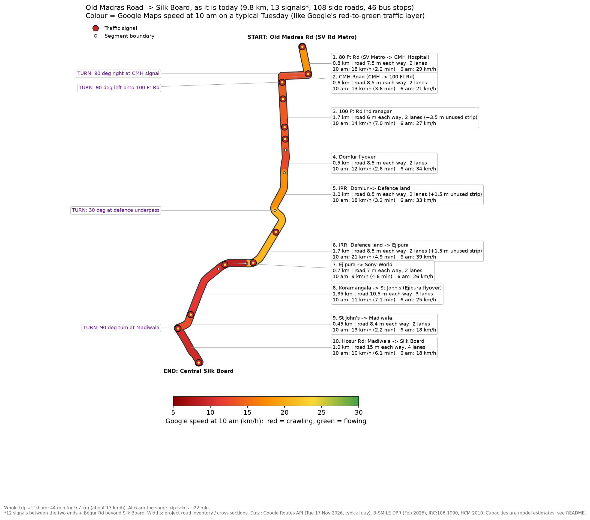
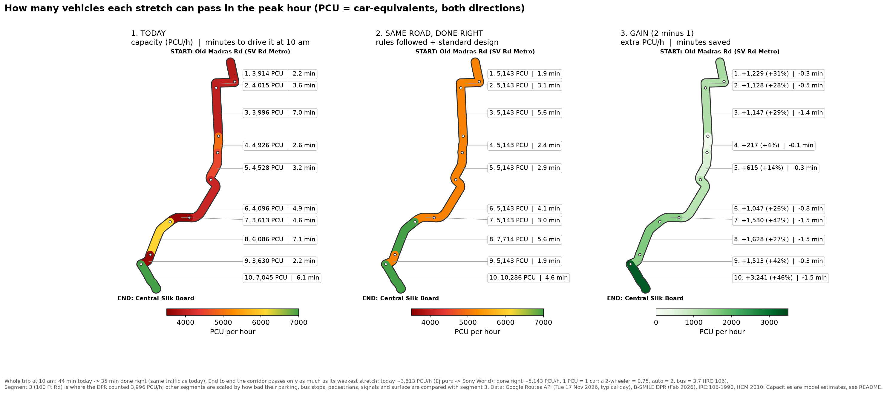
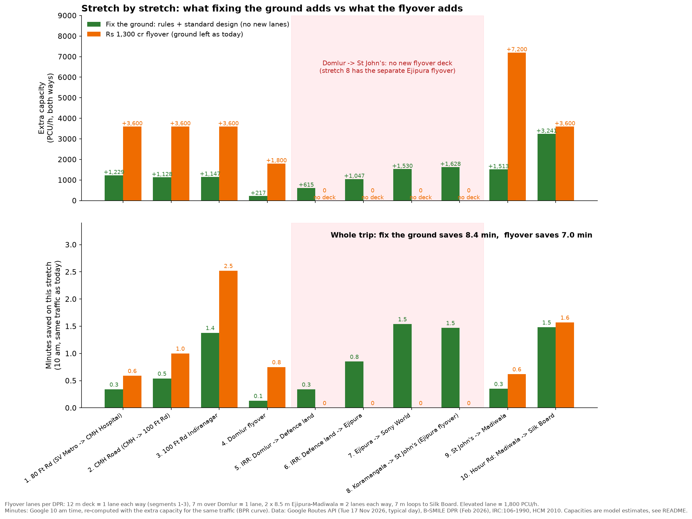
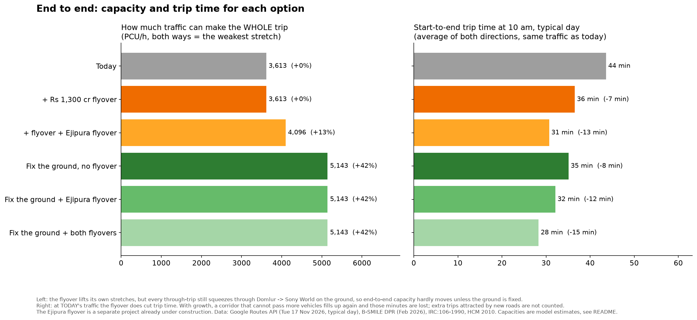
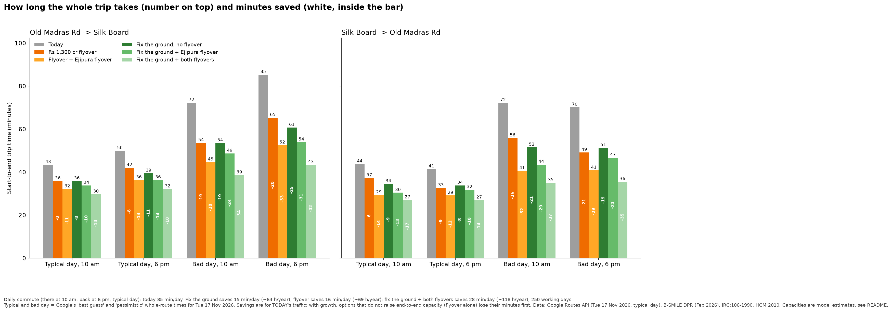

# Old Madras Road to Silk Board: does it need a Rs 1,300 crore flyover?

### A plain-language look at the road we already have

---

## The short answer

**Old Madras Road to Silk Board, start to end (about 10 km), from Google Maps on a normal Tuesday:**

| When | Today | Fix the ground (no flyover) | Rs 1,300 cr flyover | Fix the ground + both flyovers |
|---|---|---|---|---|
| 6 am (empty road) | 23 min | – | – | – |
| 10 am, typical day | **43 min** | 36 min (**saves 8**) | 36 min (saves 8) | 30 min (saves 14) |
| 6 pm, typical day | **50 min** | 39 min (**saves 11**) | 42 min (saves 8) | 32 min (saves 18) |
| 10 am, bad day | **72 min** | 54 min (**saves 19**) | 54 min (saves 19) | 39 min (saves 34) |
| 6 pm, bad day | **85 min** | 61 min (**saves 25**) | 65 min (saves 20) | 43 min (saves 42) |
| **Daily commute** (there 10 am, back 6 pm) | **85 min/day** | saves **15 min/day, ~64 h/year** | saves 16 min/day, ~69 h/year | saves 28 min/day, ~118 h/year |

- **The road is badly run, not just too narrow.** The same trip takes 23 minutes at 6 am and 43-50 minutes at peak. On a bad day it can take 85 minutes.
- **Fixing the ground saves about as much time as the flyover**: 8-11 minutes on a typical day and up to 25 on a bad day. It needs no new lanes and no new concrete. It also lets **42% more vehicles make the whole trip**.
- **The Rs 1,300 crore flyover leaves the worst stretch untouched.** Between **Domlur and Sony World** no flyover is planned: the government committee dropped it. So **not a single extra vehicle can make the whole trip (+0%)**. As traffic grows (about 4% a year), the queue there builds back and the flyover's minutes are eaten up first.
- **Fix the ground first.** It is cheaper and quicker, and it gives the same time savings with room to grow. The best result is fixing the ground and then adding flyovers, but the flyovers only pay off after the ground is fixed.

All minutes are for **today's traffic**. "Bad day" is Google's pessimistic estimate for the same Tuesday.

---

## 1. The road today

**What you're looking at.** The road runs from Old Madras Road (top) to Silk Board (bottom). It is cut into **10 stretches** at the main junctions. The colour is Google Maps' speed at **10 am on a normal Tuesday**, on the same red-to-green scale Google uses. Red dots are traffic signals. Purple labels are sharp turns.

| | |
|---|---|
| Length | 9.8 km (11.6 km in the government's project report, which runs on to Begur Road) |
| Traffic signals | 13, roughly one every 800 m |
| Side roads joining | 108, roughly one every 100 m on each side |
| Bus stops | 46, **none** with a bus bay |
| Lanes | Mostly **2 each way**: 3 on the Koramangala stretch, 4 on Hosur Road |
| Narrowest | **100 Ft Road, Indiranagar: only 6 m each way**. Next to it is an unused 3–5 m paved strip used for parking and auto stands |
| Sharp turns | 90° at CMH signal, 90° onto 100 Ft Road, 90° at Madiwala |

**The slowest stretches at 10 am:**

| Stretch | Speed at 10 am | Speed at 6 am |
|---|---|---|
| 7. Ejipura → Sony World | **9 km/h** | 28 km/h |
| 10. Hosur Road → Silk Board | 10 km/h | 19 km/h |
| 8. Koramangala → St John's | 11 km/h | 27 km/h |

---

## 2. How much each stretch can carry: today vs. done right

**PCU** means "passenger car unit": one car = 1, a two-wheeler = 0.75, an auto = 2, a bus = 3.7. It lets us add up very different vehicles.

- Each label shows **capacity (PCU per hour) | minutes to drive that stretch at 10 am**.
- **Panel 1, today:** how many PCU per hour each stretch can actually pass at peak hour. On 100 Ft Road (stretch 3) this is the government's own count: **3,996 PCU/h**. The other stretches are scaled by how much worse or better their parking, bus stops, pedestrians, signals and surface are.
- **Panel 2, done right:** the same lanes, run the way India's own road standard (IRC:106) assumes for a main road. No vehicles stand on the carriageway, access is controlled, buses use bays and signals work.
- **Panel 3, gain:** the difference, in extra PCU and in **minutes saved**. **Every stretch gains**, from +4% on the Domlur flyover, which already works well, up to **+42–46%** at Sony World, Madiwala and Hosur Road. The biggest time savings, about 1.4-1.5 minutes each, come on 100 Ft Rd, Sony World, Koramangala and Hosur Rd.

| Stretch | Today: PCU/h, minutes | Done right: PCU/h, minutes | Gain |
|---|---|---|---|
| 1. 80 Ft Rd | 3,914, 2.2 min | 5,143, 1.9 min | +1,229 (+31%), 0.3 min saved |
| 2. CMH Road | 4,015, 3.6 min | 5,143, 3.1 min | +1,128 (+28%), 0.5 min saved |
| 3. 100 Ft Rd, Indiranagar | 3,996, 7.0 min | 5,143, 5.6 min | +1,147 (+29%), 1.4 min saved |
| 4. Domlur flyover | 4,926, 2.6 min | 5,143, 2.4 min | +217 (+4%), 0.1 min saved |
| 5. IRR, Domlur → Defence land | 4,528, 3.2 min | 5,143, 2.9 min | +615 (+14%), 0.3 min saved |
| 6. IRR, Defence land → Ejipura | 4,096, 4.9 min | 5,143, 4.1 min | +1,047 (+26%), 0.8 min saved |
| **7. Ejipura → Sony World** | **3,613, 4.6 min** | 5,143, 3.0 min | **+1,530 (+42%), 1.5 min saved** |
| 8. Koramangala → St John's | 6,086, 7.1 min | 7,714, 5.6 min | +1,628 (+27%), 1.5 min saved |
| 9. St John's → Madiwala | 3,630, 2.2 min | 5,143, 1.9 min | +1,513 (+42%), 0.3 min saved |
| 10. Hosur Rd → Silk Board | 7,045, 6.1 min | 10,286, 4.6 min | +3,241 (+46%), 1.5 min saved |
| **Whole trip** | **44 min** | **35 min** | **8 min saved** |

Minutes are the time to drive each stretch at 10 am. "Done right" minutes are worked out for the **same traffic as today**: the road has more room, so the same cars move faster.

**What "done right" means in practice:**

- **Enforcement:** tow parked vehicles, no stopping in lanes, yellow boxes at junctions, clear vendors off the road.
- **Design:** bus bays, continuous footpaths and safe crossings, lane markings, fewer gaps in the median.
- **Signals:** adaptive and coordinated, with no manual override.
- **Maintenance:** a smooth surface and working drains.

---

## 3. Fixing the ground vs. building the flyover, stretch by stretch

- **Green:** fixing the ground, with no new lanes.
- **Orange:** the proposed Rs 1,300 crore flyover, with the ground left as it is today.
- **Top panel:** extra capacity (PCU per hour).
- **Bottom panel:** minutes saved on each stretch at 10 am (typical day, both directions averaged).

| Stretch | Fix the ground: extra PCU, minutes saved | Flyover: extra PCU, minutes saved |
|---|---|---|
| 1. 80 Ft Rd | +1,229, 0.3 | +3,600, 0.6 |
| 2. CMH Road | +1,128, 0.5 | +3,600, 1.0 |
| 3. 100 Ft Rd | +1,147, 1.4 | +3,600, 2.5 |
| 4. Domlur flyover | +217, 0.1 | +1,800, 0.8 |
| 5. IRR, Domlur → Defence | +615, 0.3 | **0, 0 (no deck)** |
| 6. IRR, Defence → Ejipura | +1,047, 0.8 | **0, 0 (no deck)** |
| 7. Ejipura → Sony World | +1,530, 1.5 | **0, 0 (no deck)** |
| 8. Koramangala → St John's | +1,628, 1.5 | **0, 0 (separate Ejipura flyover)** |
| 9. St John's → Madiwala | +1,513, 0.3 | +7,200, 0.6 |
| 10. Hosur Rd → Silk Board | +3,241, 1.5 | +3,600, 1.6 |
| **Whole trip** | **8.4 min** | **7.1 min** |

Where the flyover deck exists (Indiranagar and Madiwala → Silk Board), it adds more on that stretch, because it is new lanes. **Across stretches 5 to 8 (Domlur → St John's) it adds nothing.** Fixing the ground helps **every** stretch, including the four the flyover skips.

---

## 4. End to end: a road is only as good as its worst stretch

A trip from Old Madras Road to Silk Board passes through all 10 stretches. **Only as much traffic can make the whole trip as the narrowest stretch allows.**

| Option | Vehicles that can make the whole trip | Trip time at 10 am* | Time saved |
|---|---|---|---|
| Today | 3,613 PCU/h | 44 min | – |
| + Rs 1,300 cr flyover | 3,613 PCU/h (**+0%**) | 37 min | 7 min |
| + flyover + Ejipura flyover | 4,096 PCU/h (+13%) | 31 min | 13 min |
| **Fix the ground, no flyover** | **5,143 PCU/h (+42%)** | **35 min** | **8 min** |
| Fix the ground + Ejipura flyover | 5,143 PCU/h (+42%) | 32 min | 11 min |
| Fix the ground + both flyovers | 5,143 PCU/h (+42%) | 28 min | 15 min |

*Typical day, average of both directions. Each direction, other times and bad days are in section 5.

**How to read the two columns together:**

- **Time saved** is for **today's traffic**. Both the flyover and fixing the ground cut the trip by 8–9 minutes.
- **Vehicles that can make the whole trip** decides **how long those minutes last**. Traffic on this corridor grows about 4% a year (government forecast). With the flyover alone, the corridor still cannot pass a single extra car end to end, so the queue at Domlur → Sony World builds back up and the minutes are lost. Fixing the ground raises the ceiling by 42%, which is room for roughly 9 years of growth.
- **The best result comes from fixing the ground and then adding flyovers** (27 min). Even then, the flyovers only add minutes after the ground is fixed.

---

## 5. Start to end: how long the whole trip takes

The number on top of each bar is the **whole trip time in minutes**. The white number inside is the **minutes saved** compared with today.

| Old Madras Rd → Silk Board | Today | Flyover | Flyover + Ejipura | **Fix ground** | Fix ground + Ejipura | Fix ground + both |
|---|---|---|---|---|---|---|
| Typical day, 10 am | 43 | 36 (-8) | 32 (-11) | **36 (-8)** | 34 (-10) | 30 (-14) |
| Typical day, 6 pm | 50 | 42 (-8) | 36 (-14) | **39 (-11)** | 36 (-14) | 32 (-18) |
| Bad day, 10 am | 72 | 54 (-19) | 45 (-28) | **54 (-19)** | 49 (-24) | 39 (-34) |
| Bad day, 6 pm | 85 | 65 (-20) | 52 (-33) | **61 (-25)** | 54 (-31) | 43 (-42) |

| Silk Board → Old Madras Rd | Today | Flyover | Flyover + Ejipura | **Fix ground** | Fix ground + Ejipura | Fix ground + both |
|---|---|---|---|---|---|---|
| Typical day, 10 am | 44 | 37 (-6) | 29 (-14) | **34 (-9)** | 30 (-13) | 27 (-17) |
| Typical day, 6 pm | 41 | 33 (-9) | 29 (-12) | **34 (-8)** | 32 (-10) | 27 (-14) |
| Bad day, 10 am | 72 | 56 (-16) | 41 (-32) | **52 (-21)** | 44 (-29) | 35 (-37) |
| Bad day, 6 pm | 70 | 49 (-21) | 41 (-29) | **51 (-19)** | 47 (-23) | 36 (-35) |

**For a daily commuter** going to Silk Board at 10 am and coming back at 6 pm on a typical day:

| Option | Commute today: 85 min/day | Saved per day | Saved per year (250 working days) |
|---|---|---|---|
| Rs 1,300 cr flyover | 68 min | 16 min | ~69 hours |
| **Fix the ground, no flyover** | **70 min** | **15 min** | **~64 hours** |
| Fix the ground + both flyovers | 57 min | 28 min | ~118 hours |

**Why the stretch-by-stretch minutes look small.** The whole trip is the sum of 10 stretches of 0.5-1.7 km each, so each stretch only takes 1.5-7 minutes. A saving of 1-1.5 minutes per stretch adds up to 8-11 minutes over the whole trip, and 20-25 minutes on a bad day. The stretch numbers are scaled so they add up exactly to Google's whole-trip time.

---

## What this means

1. **Fix the ground first.** It saves 8-11 minutes per trip on a typical day and up to 25 minutes on a bad day, about 64 hours a year for a daily commuter. It lifts every stretch, including the four the flyover skips, and it is cheap and quick. Most of it is enforcement, paint, bus bays and signal timing.
2. **Measure again after fixing.** The flyover was justified with a single day's count, taken on a road where parking, bus stops and broken footpaths were already eating its capacity.
3. **If more capacity is still needed, look at Domlur → Sony World first.** That is where the corridor chokes, and where the flyover does nothing. The unused 3–5 m paved strips on 100 Ft Road and the IRR could also become bus lanes. One bus lane moves about as many **people** as the flyover would.

---

## Honest caveats

- **One count only.** The government's traffic count is a single day at a single spot (100 Ft Road, 25 April 2025). Every other stretch is estimated from it.
- **Severity ratings are judgement.** How much worse each stretch is than 100 Ft Road (parking, bus stops, pedestrians, signals, surface) was graded from the project report's own photos and news reports. Those grades are estimates.
- **"Done right" uses the national standard for the same lanes:** IRC:106-1990, arterial road, 1,286 PCU per lane per hour. It is a standard, not a promise.
- **No turning traffic.** Side-road traffic joining and leaving the corridor is not modelled. Trips that use only one flyover stretch, such as Indiranagar or Madiwala, do gain locally (chart 3).
- **Time saved assumes today's traffic.** The minutes come from Google's real 10 am times, re-worked for the extra room using the standard BPR speed-flow curve, with the same number of vehicles as today. They do not include traffic growth, or the extra trips that new road space attracts. Both would eat into the flyover's minutes faster than into fixing the ground, because the flyover does not raise the corridor's end-to-end ceiling.

**Sources:**

- B-SMILE Detailed Project Report (Feb 2026) and drawings
- IRC:106-1990 *Guidelines for Capacity of Urban Roads in Plain Areas*
- HCM 2010
- Google Routes API, Tuesday 17 Nov 2026, typical-day traffic
- Bengaluru Traffic Police adaptive-signal results (2024)

The full method and assumptions are in `../README.md`. Every number can be changed in `../segments_silk_board.py` and `../inputs_silk_board.py`. The per-stretch numbers are in `segments.csv` in this folder. To regenerate everything in this folder, run `python segment_model.py && python segment_charts.py`.
